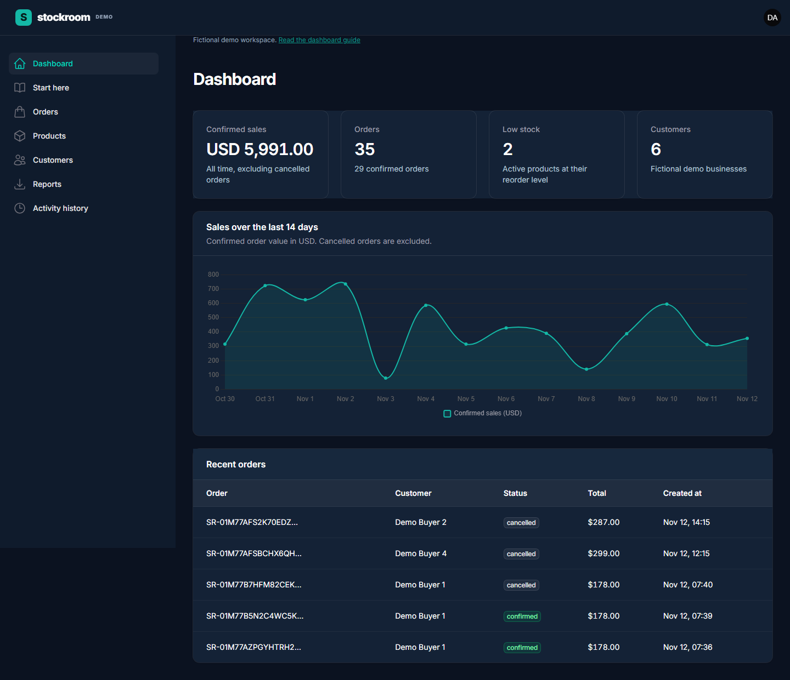

# Stockroom

Stockroom is a working order and inventory dashboard built with Laravel 13 and Filament 5. It demonstrates backend business rules through a usable administration interface.

Created by Abdulrhman Yaghi. All demo people, businesses and transactions are fictional.

[Open the guided preview](https://abdulrhman-yaghi.github.io/stockroom/)

[Watch the walkthrough](https://abdulrhman-yaghi.github.io/stockroom/#watch)



## What makes it useful

1. Orders use stored product prices and atomic stock deductions. If any item is unavailable, the complete order rolls back.
2. Cancellation restores stock exactly once. Repeating the cancellation does not create extra inventory.
3. Administrators manage products, customers, stock adjustments and reports. Staff can place orders and cancel their own orders.
4. CSV reports run through a queue, respect inclusive UTC dates, exclude cancelled orders and can be downloaded only by their requesting administrator.
5. Activity history records order confirmation, cancellation, stock adjustments and report requests with the responsible user.
6. An in app guide explains the workflow and suggests useful edge cases to try.

## Preview and application

The hosted preview contains a guided tour, real screenshots and an edited recording of the application. It is a static presentation, not a hosted PHP application. Changes cannot be made from the preview.

The complete Laravel application runs locally using the steps below. This separation keeps a public demo from exposing a shared administrator account or a writable database.

## Requirements

PHP 8.4 or later, Composer 2, Node.js 22.12 or later and npm are required. Enable the PHP SQLite, PDO, Intl, Mbstring, XML, Fileinfo and Zip extensions. The verified environment uses PHP 8.4 and SQLite. MySQL and PostgreSQL have not been verified for this release.

## Quick start

1. Clone the repository and enter its directory.

```sh
git clone https://github.com/Abdulrhman-yaghi/stockroom.git
cd stockroom
```

2. Install the PHP packages and create the disposable demo database.

```sh
composer install
composer run demo
```

The demo command creates the local environment file if necessary, generates the application key, creates the SQLite database, migrates the schema, seeds fictional data and publishes Filament assets. Use it once on a fresh checkout. It refuses to seed over existing product, customer or order data.

3. Install and build frontend assets.

```sh
npm ci
npm run build
```

4. Start the application in one terminal.

```sh
php artisan serve
```

5. Start the report worker in a second terminal.

```sh
php artisan queue:work
```

6. Open http://127.0.0.1:8000/admin and sign in.

Administrator email: `admin@stockroom.test`

Staff email: `staff@stockroom.test`

Password for both demo accounts: `StockroomDemo!2026`

These are intentionally public credentials for the local fictional demo. Never use them for an internet facing production application.

## Your first five minutes

1. Open Start here for the built in guide.
2. Open Dashboard to review sales, orders and low stock.
3. Open Products and use the Low stock only filter. As administrator, adjust stock and enter a reason.
4. Open Orders and select Place order. Choose a customer, product and quantity. The database decides the final price and available stock.
5. Open Details to inspect the order lines. Cancel a confirmed order and verify that its stock returns.
6. Open Reports as administrator, choose a date range and generate a CSV. Wait for Ready and download it.
7. Open Activity history to follow the operational events.
8. Sign out and sign in as staff. Reports and Activity history should be unavailable. Product editing and stock adjustment should also be unavailable.

For a full walkthrough, read [the usage guide](docs/guide.md).

## Verification

```sh
composer test
npm run test:browser
```

Before the first browser test run, install Chromium:

```sh
npx playwright install chromium
```

The browser suite requires the seeded local database and the queue worker. It starts the application server when one is not already running. Browser workflow tests create and cancel demo orders and generate reports, so use a disposable demo database.

The PHP suite uses isolated databases. It includes rollback, authorization, report filtering, private downloads, spreadsheet formula escaping, Livewire form actions and two simultaneous processes competing for the last stock unit.

See [verification details](docs/verification.md) for the measured scope and limitations.

## Architecture

Filament resources collect and validate input. OrderService, InventoryService and ReportService enforce business rules and permissions. Laravel transactions protect related writes. GenerateSalesReport builds private CSV files using the database queue. ReportDownloadController checks ownership before returning a file.

Money is stored as integer cents in USD. Order items snapshot product names and prices. The application does not process payments or calculate tax, shipping, discounts or refunds.

Read [architecture and tradeoffs](docs/architecture.md) for the data model and concurrency approach.

## Deployment

The GitHub Pages guide is served from the docs directory. The application itself requires a PHP host, a persistent database, persistent private storage and a queue worker. Before a production deployment, set a unique application key, disable debug output, use HTTPS, replace demo accounts and configure backups and worker supervision. The demo seeder refuses to run outside local or testing environments.

## Demo video

The video uses real application recordings, chapter captions and edited transitions. No customer data or production credentials appear in the footage. The recording script and editing script are included in scripts so the walkthrough can be reproduced after changes.

## License

MIT. See [LICENSE](LICENSE).
